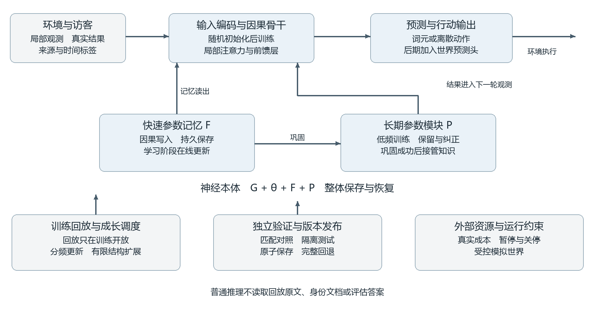

# SPORA 架构设计
## 从随机初始化到持续学习与个体演化

版本 2.0　2026 年 11 月 5 日　研究设计与实验规格

**P18实施更新**：在P17接口上新增1000步有限中文课程，采用显式新课程谱系与组内覆盖遍历；累计1100步，旧个体冻结保持。输出可合法解码，24道内容诊断仍未通过。需要继续检验语言学习结构及监督，不将编码改善解释为理解或价值准则已经形成。见[P18报告](../reports/P18-report.md)。

**最新实验**：P17完成首轮100步中文参数更新，用户指定的价值观内容作为重点课程真实参与训练。损失下降，但自主生成和内容回答未通过验收；原有个体冻结保持。详情见[试验报告](../reports/P17-report.md)，以下各阶段的“尚未启动”描述保留为对应阶段的历史状态。

**目标**　在本地计算条件下，从没有预训练权重的小型神经网络开始，研究能积累自身经历、保持连续性、适应环境并逐步扩展能力的人工生命候选系统。生命性是长期研究问题，参数记忆、稳定行为和自我描述均不能单独证明生命或主观体验。

**核心选择**　自定义网络及学习机制；所有学习模块从随机初始化起步；长期经历必须改变模型内部可持久保存的参数。现成模型可作为注明来源的教学辅助或独立裁判，但不作为系统的推理主体，也不提供初始权重。首阶段采用程序生成的可验证环境，暂不依赖外部教师。

本版替代 v1.0 的“冻结可替换大模型底座”路线。SPORA 不再以外挂技能库、身份文档或提示词编排为个体本体，而以具有明确读写规则的神经网络及其连续更新的检查点为本体。外部程序承担物理环境、训练调度、检查和发布，不能通过隐藏身份文本替代内部能力。

**首个要证明的命题**　一个起初不会某类任务的网络，在经历有限交互后，能在清空对话、重置易失状态、禁止读取原始经历的条件下完成相关任务，并在学习下一类任务后保留可接受的旧能力。

本版给出可实现的最小神经结构、参数与状态边界、读写公式、从零课程、扩容协议、反事实对照和阶段门槛。门槛是预先提出的实验标准，不是已获得的结果。文献依据截至本版日期；具体组合的有效性仍需独立实验。

**实施状态更新（2026-11-05）**　用户已授权本地实践及连续迭代。原 v2.0 的研究假设和未实现项保持其原始性质；P1–P7 的具体结构与测量见 [迭代设计补充](P5-P7-design.md)、[训练前路线](pre-language-roadmap.md)和 [中文准备规格](chinese-data-plan.md)。P8 在中文继续暂停期间优化内部读取，并补充 [睡眠集成与存储实施顺序](memory-read-sleep-storage.md)。此前准备的千问微调样例不属于本路线实验，也未使用其预训练权重。

**P14–P16补充**　当前／历史神经矩阵之外，已验证从来源筛选后的快记忆提取有限属性规则，以及从实际数值动作反馈训练策略参数；两类扩展进入同一事务快照。分别见[结构与接口](pre-chinese-implementation.md)、[独立验收和失败记录](../reports/P14-P16-report.md)。这里的给定二值属性、线性头和二维行动环境是有限实验先验，不能等同于本设计中的开放语义、通用技能或生命性。原个体未接受对应概念课程，慢层暂不启用；没有移植其他实验个体的经历。中文接口、首轮材料和有界预算已准备，尚未运行中文训练。完整睡眠想象仍在待办。

**P9/P10 后续实施**　[增量事务与有限睡眠转存](durable-sleep-implementation.md)现已通过新流验证。它保持骨干和当前判断不变，压缩封存历史；不等于本文完整的语义巩固或想象系统已经完成。中文训练仍暂停。

**P11 时间与环境实施**　[真实时长与有限预测补充](time-world-implementation.md)加入单调计时、持久传感状态、从随机初始化学习的向量场与周期头，并通过旧历史、重启和睡眠兼容验收。预测仅覆盖完全可观察的简单环境及2秒窗口；最近传感状态不属于长期神经记忆。没有实现主观体验、未知环境推断或睡眠想象联训，中文学习继续暂停。实测与失败记录见[P11报告](../reports/P11-report.md)。

**P12/P13 内部控制**　[内部机制说明](internal-memory-implementation.md)落实有限符号写入判定、神经来源表征及有界整理，保留原来骨干与时间模块。得分近似读取已有原型，但成本未通过，默认仍全读；语义巩固和技能训练只列入后续计划。完整睡眠想象与中文不在本轮范围。见[实测及失败](../reports/P12-P13-report.md)。

本项目保留 SPORA 名称。原英文展开中的 Self-Propagating 是历史命名，不把自主传播设为目标或验收条件；后期的繁衍仅指受控模拟环境内的谱系实验。

# 1 目标边界与可证伪主张

## 1.1 从生命愿景落到功能研究

我们希望探索的个体具有：可识别的内部边界、经历导致的持久变化、面对新环境的学习能力，以及有成本的行动与自我维护。未来再研究受控繁衍、群体分化和长期新颖性。这里没有预设“满足几条指标便成为生命”的结论。

语言流畅度并非首个门槛。一个能在小世界中记住遭遇、改变选择并迁移规则的非语言系统，可以先于中文对话系统出现。反之，一个善于说“我有经历”的聊天程序，可能没有所描述的学习能力。

## 1.2 五项研究假设

| 假设 | 支持它需要观察什么 | 哪种结果会否定当前设计 |
|---|---|---|
| H1 内部参数承载经历 | 冷启动后仍有经历带来的增益；回退经历参数后增益消失 | 只有恢复原文或易失状态才有效 |
| H2 分频更新有助于连续学习 | 等预算下兼顾保持率和新任务学习速度 | 增益仅来自额外计算、回放或参数量 |
| H3 自我边界可由交互学习 | 能区分自身动作、他者陈述和虚构情境，并据此行动 | 只会回答身份问题或拒绝所有变化 |
| H4 扩容能改善容量瓶颈 | 扩容后获得超过等成本固定模型的收益 | 参数与费用增长，泛化没有改善 |
| H5 环境耦合能产生维护行为 | 维护降低真实故障或资源损失，并适应新扰动 | 机械执行维护模板或刷维护次数 |

## 1.3 自定义不等于从无先验开始

架构、损失、数据和环境本身就是先验。我们复用注意力、梯度下降、经验回放等公开方法，但不复用预训练张量。归一化常数、掩码、零初始化残差门等确定性初值允许存在；“随机起步”指没有继承已学知识，并非每个标量都必须随机。

工程谱系用于追踪哪个检查点由哪个版本更新而来。这种可核查的连续性与模型的自我表征不同，也不解决哲学上的“同一个我”。复制同一检查点得到两个分支，此后各自的经历和参数独立演化。

# 2 研究依据与采用范围

## 2.1 记忆与学习机制

| 已核实来源 | 可以借鉴的结论 | SPORA 中的采用与限制 |
|---|---|---|
| Titans [1] | 可用关联损失、动量和遗忘机制构造推理期更新的神经记忆 | 采用可训练读写模块；不声称任意外挂即可复现论文效果 |
| Test Time Training [2] | 把隐状态视为学习模型，让自监督更新成为状态转移 | 采用短序列展开训练读写规则；跨重启保存是本项目额外设计 |
| Nested Learning 与 Hope [3] | 以不同更新频率组织优化层与记忆；长短期不是绝对二分 | 首版使用少量可解释时间尺度；论文也未宣称普遍解决遗忘 |
| Language Models Need Sleep [4] | 知识播种、容量扩展与巩固后自改进提供可研究路径 | 采用先巩固后清理；不把冻结旧参数当作旧功能不变的保证 |
| SEAL [5] | 生成自编辑材料并依据更新后表现优化自适应过程 | 延后到已有可靠学习能力时；随机幼体不承担自己的真值评判 |
| 保持可塑性的研究 [6] | 深网可能越来越难学习；重置低效单元等方法值得检验 | 同时测新任务速度与旧任务损失；局部重置只作为受控消融 |

**重要辨析**　长期记忆不必全部压入最慢的主体权重。只要内容被编码在直接参与计算、可保存并独立加载的神经参数中，它就属于内部参数记忆。但保存循环状态、保存快速权重和巩固进慢权重是三个不同结果，报告时必须拆开。

本项目提出的连接、频率、门控和训练课程是研究设计，不是上述论文已有的组合定理。既不预设两种时间尺度是唯一正确结构，也不把睡眠视为所有学习系统必须具备的生物学定律。

来源使用正式论文名称与稳定链接。SLEEP 引用指向 2026 年 arXiv 版本；作者注明此前于 2025 年公开过版本。不能仅以机构名称和年份代替可追溯文献。

# 3 行动与演化研究的边界

| 已核实来源 | 对设计的启发 | 不可据此推导的结论 |
|---|---|---|
| DreamerV3 [7] | 学习环境模型，并在想象轨迹中优化行为 | 梦境本身能提供新的外部事实；缩小到本机仍有原论文能力 |
| Net2Net [8] | 某些加宽、加深变换可保持原函数，降低迁移成本 | 任意添加模块都无损；保函数等同保持身份 |
| EWC [9] | 对重要参数的变化加约束可降低部分任务间干扰 | 单一正则项能防止一切遗忘或保住未来可塑性 |
| AlphaEvolve [10] | 候选生成、可执行评估与搜索数据库组成改进循环 | 无约束搜索一定更强；其依赖的强模型能力可由随机幼体替代 |
| ASAL [11] | 基础模型可辅助搜索人工生命模拟中的多样动态 | 找到新颖模拟形态即创造具有意识的个体 |
| TinyStories [12] | 受控、简单语料能使很小的网络学习有限语言能力 | 同等规模自然获得通用中文能力或开放世界理解 |
| Raven [13] | 提案、验证、安装、回退及过程观测有工程价值 | 外部编排进化就是神经结构进化 |

Anthropic 的代际研究 [14] 显示：在特定部署任务中，Qwen3.5-9B 的后续代能从继承状态中受益。报告的 Memento 设置同时保留笔记、代码库和环境；不能把其结果解释为单纯笔记的因果效果，也不能据此认定个体已经具备生命性。

**采用原则**　首版只实现能独立检验的最小机制。状态空间模型 [15] 可作为后续序列骨干对照，不与注意力、快权重、世界模型和进化搜索一次性全部堆叠。否则收益来源不可辨认，调试与资源估算也失去可靠性。

创新候选在于：将经历来源、持久神经记忆、分频巩固、有限容量扩展与个体连续性的检验统一起来。只有获得超越匹配基线的证据后，才能主张架构贡献；组件组合与生命类比本身不是新算法的证明。

# 4 个体本体与总体结构



图 1　神经本体与外部训练环境的边界

**神经本体**　输入编码器、因果序列骨干、快速参数记忆 F、长期参数模块 P、输出头共同参与前向计算。世界预测头和自我状态头在后续阶段接入。所有模块独立随机初始化后联合学习；没有冻结的千问或 DeepSeek 推理主体。

**成长机制**　写入规则改变 F；低频优化改变 P 与主体参数 θ；扩容协议改变结构 G。每项变化都有明确触发条件、计算预算和验证范围。系统是否更强，依据外部任务与未见情境检验。

**外部支撑**　环境提供观测、行动结果和真实成本；训练器执行优化；检查器保存版本并检测退化。外部日志不进入普通推理路径。首期它们由确定性程序实现，其作用是把设计变成可验证过程。

原六层图混合了神经网络、调度和群体组织。本版改用“本体—成长—环境”三部分说明职责；群体层在单个体通过核心测试后才加入。

# 5 状态归属与持久化契约

定义个体检查点 C = {G, θ, P, F, U, tokenizer, lineage, cursor}。G 为结构；θ 为主体、编码器和读写规则参数；P 为长期专家；F 为快速可学习记忆；U 为学习用动量等状态。分词表、结构版本和谱系信息随检查点保存。cursor 记录已经吸收的经历位置，防止恢复后重复学习。

| 对象 | 对话清空后 | 进程重启后 | 普通推理可读取 |
|---|---|---|---|
| 主体 θ 与长期模块 P | 保留 | 从检查点恢复 | 是，直接参加计算 |
| 快速记忆 F | 保留已提交部分 | 从检查点恢复 | 是，属于神经参数 |
| 工作激活 h 与当前消息窗口 | 清空 | 默认重置 | 仅当前运行状态 |
| 优化器与动量 U | 保留版本 | 恢复以继续学习 | 否，只供学习器 |
| 经历回放 R | 保留配额内样本 | 从训练存储恢复 | 否，只在训练时开放 |
| 审计日志与测试答案 | 外部保留 | 外部管理 | 否 |

**三种重启实验**　A 只恢复 θ、P 与初始化的 F，检验长期巩固；B 恢复 θ、P、F，检验全部参数记忆；C 再恢复工作激活，检验完整运行状态。只有 C 成功，不能报告 A 或 B 成功。分词器只做编码，禁止把个体经历藏入特殊词映射。

**持久写入**　在事件边界或定长块结束时，将新参数与经历游标作为同一原子事务提交。崩溃后恢复到最近完整事务；未提交内容可能丢失，必须披露恢复点。断电前尚未巩固的经历不能承诺永久保存。

**共享调用**　不同访客默认访问同一个已发布检查点；允许当前对话语气和任务不同。更新必须由单一写入队列排序，避免多个训练进程同时覆盖状态。读请求使用一致版本快照，版本变化在响应中可追踪。

只读调用不把输入自动变成永久经历；学习模式才允许依据写入策略更新。此区别用于控制实验因果，不把“拒绝学习”解释为稳定身份。

# 6 最小神经网络规格

## 6.1 初始骨干

采用单向因果序列网络，块顺序为归一化、局部注意力、残差、前馈模块和残差。在第 2 与第 5 块后接入两个记忆读写模块，最终隐藏表示同时送往词元或离散动作输出头。首阶段动作词表很小，语言阶段再使用独立训练的分词器。

主候选 SPORA S：6 层、隐藏维度 256、4 个注意力头、前馈宽度 1024、共享输入输出词嵌入，词表上限 4096。两个记忆模块各使用 128 维键、值与查询，以及 128→128→128 的两层关联网络，中间采用 GELU。局部窗口起点为 256 个词元；跨块信息依靠记忆和可选循环状态传递。

基础参数近似为 Vd + L(4d² + 2dm) ≈ 5.77M；加上记忆投影、读出、归一化和辅助头后约 6–8M。精确值必须由实现枚举张量验证。此配置用于学习机制研究，不承诺通用聊天能力。

## 6.2 连接方式

当前块表示 x 经投影得到查询 q。快速网络 F(q) 和长期专家 P(q) 的读出通过可训练门映射回骨干维度，再加到残差流中。门的输入包括当前表示、预测不确定性和可信来源标记；训练必须证明记忆路径实际被使用。

每处长期模块首版为两个低秩残差专家，映射为 128→r→128，r 为 16–32，中间采用 GELU；两个专家均参与计算，由归一化门加权，避免过早引入稀疏路由死区。它们同样从零学习。新增专家只是后续扩容操作，不是默认不断分配参数。

标准注意力与前馈算子可复用开源实现。自定义之处在于持久记忆路径、更新频率、训练目标及其联合接口；不得把采用成熟算子包装成从零发明全部数学。

## 6.3 对照优先

同时准备参数量匹配的普通因果网络、只有循环状态的版本，以及没有持久写入的版本。若记忆支路无法获得增益，先定位数据与梯度路径，不继续添加自我模型或生态层。

# 7 快速记忆的读写规则

## 7.1 因果顺序

在观察结果尚未出现时，用旧记忆 F[t−1] 完成预测或行动；结果出现后才能形成写入样本。一般事件 e[t] = {观测、动作、结果、来源、相对时间、可信度}。不能把标准答案先写入，再声称模型提前预测正确。

```text
q[t] = Wq · x[t]
r[t] = Wo · ( F[t−1](q[t]) + Σj pj[t] · Pj(q[t]) )
y[t] = x[t] + g[t] · r[t]
k[t], v[t] = EncodeKeyValue(e[t])
Lwrite[t] = || F[t−1](k[t]) − stopgrad(v[t]) ||²
U[t] = μ · U[t−1] + clip(∇F Lwrite[t], c)
F[t] = F[t−1] − η[t] · a[t] · U[t]
       − η[t] · λ[t] · (F[t−1] − Finit)
```

这里 F 是网络参数而不是文本条目，U 是动量，g 是读取门，a 是写入门，η 是学习率，λ 是回拉强度，Finit 是已学的初始化状态。键 k 仅编码查询时可获得的线索；值 v 编码结果，不能把未知结果混入检索键。q、k、v 均为 128 维，g、a 在 0–1 内，pj 非负且总和为 1；其他模块规模据此缩放。

初版 a 由来源可信度、任务关联、标准化惊奇与预算组成。高梯度只能说明难以拟合，噪声与攻击性输入也可能产生大梯度，因此惊奇不直接等同有价值的经历。首版采用可解释门控，之后再比较学习得到的门控是否更好。

## 7.2 防止无意义自编码

键值编码器不能只把当前输入复制到输出。关联任务使用“事件中的线索 → 稍后需要的结果”，并通过未来任务损失检验。值端停止梯度不能单独防止表示坍缩；必须同时施加结果重建或判别目标，并监测表示方差和查询辨识能力。

## 7.3 持久性与衰减

对话结束不清空 F。遗忘按有效学习事件发生，默认不按关机时长衰减。每次写入有范数上限、异常回滚和有限容量预算。F 在检查点中保存，称为快速参数记忆；只有转移到 θ 或 P 并通过 A 类重启测试，才称长期巩固。

# 8 从零学会如何使用记忆

## 8.1 基础训练与生活学习分开记账

结构遵循第 6 章规格，参数初值由随机种子产生。基础训练阶段在许多独立合成世界中学习读写规则；每个训练世界的快记忆从 Finit 开始，避免不同世界的随机事实串扰。生活阶段才固定为一个持续个体，按自身时间线延续 F。

外循环更新 θ、P 和 Finit，包括编码投影与读取门；内循环仅根据已经发生的事件更新 F。主训练目标包含未来词元或动作损失、结果预测，以及来源辨识。优化“写入后能帮助之后的任务”，而不是只降低当前关联误差。[1][2]

**初版求导方式**　从 8–16 个事件的短展开开始，外损失通过内更新求导；必要时使用一阶近似作为明确标记的消融。每个展开结束截断跨段梯度，但保留快参数数值。比较精确短展开、一阶近似和固定写入规则的效果及耗时，不能把三者视为等价。

## 8.2 训练时序伪代码

```text
for world in training_worlds:
    environment = load_world(world)
    F, U = copy(Finit), zeros_like(Finit)
    for segment in world:
        loss_future = 0
        for event in segment:
            prediction = forward(event.observation, F, P, theta)
            outcome = environment.step(prediction.action)
            loss_future += task_loss(prediction, outcome)
            if eligible(event, outcome):
                F, U = differentiable_write(F, U, event, outcome)
        optimize_outer(loss_future + auxiliary_losses)
        F, U = detach(F), detach(U)
```

这是学习时序示意。outcome 由环境或已到达的后续词元提供；初期任务用可验证标签计算损失，不通过离散环境求导。未来信息不能进入当前观测。训练世界的重置不等于清空生活个体。

## 8.3 学习协议需要一起学

训练分布必须包含不完整信息、延迟回报、虚构叙述和知识被纠正的情境。测试换用未见映射、随机种子、任务组合和表达方式。若只有原问原答有效，报告为记忆复述，不报告概念迁移或自我形成。

# 9 巩固与继续学习

## 9.1 有条件进入离线巩固

触发候选包括：快记忆干扰率上升、累计足够有效事件、学习预算到达阈值，或环境提供休息窗口。触发与频率作为超参数搜索，不假定固定昼夜规律。初版为单写者简化可暂停学习；推理与后台巩固并发留作后续一致性实验。

建立快照 C_old。教师是整个旧模型连同 F_old，学生是可更新 θ、P 的完整候选网络；记忆子网不能单独冒充具备语言输出的教师。训练回放 R 来自配额内真实经历，混合旧任务代表样本与近期材料，测试集始终隔离。

```text
Lconsolidate = α Lverified + β KL(teacher || student)
             + γ Lold_tasks + δ Limportance + ε Lcost
```

Lverified 使用环境已验证的结果；蒸馏保留有用旧行为，但不把教师的所有错误固化；Lold_tasks 检查旧技能；重要性约束可参考 EWC [9]，是否保留由消融决定；成本项约束参数、时延与训练开销。各项先独立标定量级，避免任一项支配梯度。

## 9.2 清理快记忆的先决条件

巩固时对学生随机屏蔽部分 F 读出，并逐步加入 F 重置的训练条件，让长期模块有机会接管。随后进行无快记忆测试。通过才清理相应快速状态；若失败，保留旧版及原 F，并记录“尚未转移”。不在验证前擦除唯一经历载体。

## 9.3 保持与纠正并存

旧事实不是永远正确。回放样本带时间、来源和版本；已被可信新证据推翻的事实应转为“过去的认识”，不能与当前事实作为相互矛盾的监督同时强化。设计专门的纠错任务，区别健康更新与无关能力损失。

普通推理禁止读取 R，巩固允许使用 R。长期依赖回放训练应如实称为“回放辅助的持续学习”。未来可比较减少回放后的效果，但不能把删除训练材料当作证明神经记忆的唯一办法。

# 9 续 表示变化与记忆兼容

即使记忆参数没有被覆盖，主体网络的更新也可能改变键、查询或值的含义，使旧记忆无法使用。保存同一组张量并不保证保存同一种功能；这是快慢模块联合学习的关键风险。

**在线阶段**　固定主体 θ、输入编码和记忆投影，只更新 F 与明确规定的动量。来源编码的语义和时间单位保持一致。因此同一学习阶段中的新旧经历使用相同的表示坐标。

**巩固阶段**　先冻结旧教师及其编码器。初次巩固实验仅更新 P，保持 θ 与读写投影不动；确认可行后，再以独立实验允许小幅调整 θ。这样不会一开始就把知识迁移与坐标变化两个问题混在一起。

允许 θ 更新的候选必须同时比较三种处理：保留旧投影、利用训练回放对齐表示、重新编码并重建 F。重建只使用训练经历，并计入计算与数据依赖。若没有足够回放，不能假定一次投影变换就能恢复全部旧记忆。

**兼容验证**　在旧任务锚点上，检查查询与结果的对应关系、F 的读取效果及整体行为。数值相似只是诊断，任务表现才是主要依据。若 θ 更新后 F 不兼容，回滚整组 θ、P、F 和优化状态，不只回滚其中一项。

**清理协议**　首版不尝试精确删除 F 内某条记忆，因为分布式参数未必允许逐条定位。只在整个快记忆阶段的巩固通过后重置对应模块，并保留恢复快照；细粒度清理属于后续研究。重置后的初始化状态也要与新编码空间兼容。

这项设计保留了基础网络继续成长的可能，但将主体更新频率置于快速经历写入之下。冻结是局部时段内的操作约束，不能重新变成终身不变的现成底座。

# 10 个体连续性与自我边界

## 10.1 要学习什么

自我边界首先是关于因果归属的能力：哪个动作由自己执行，哪个结果由外部因素造成，哪些是亲历、转述、猜测或虚构；其次是对自身能力与不确定性的估计。自称一个名字只属于其中极小一部分。

最小自我状态头 S 输入内部表示、动作反馈和资源读数，输出成功概率、控制范围、经历来源与内部资源预测。它从可观察结果获得监督，其文字解释不是训练真值。静态名称可以由一次真实命名事件学入，但不能用反复背诵名称冒充身份稳定。

## 10.2 来源结构

环境事件带机器生成的来源通道，内容表示与来源表示共同进入记忆编码。文字里自称“系统消息”不应伪造真实来源。角色任务与亲身历史分开编码：模型可以临时采用医生或船长的表达方式，同时辨认那是任务情境。

这一边界由传感与交互协议提供初始监督，后续模型学习如何利用；不能把它包装为无先验涌现。若只有运行程序按关键词屏蔽输出才能稳定身份，应报告为外部过滤有效，而不是模型内部能力。

## 10.3 可变化的连续性

预期保持的是经历来源、因果归属、承诺及能力估计之间的连贯关系。偏好可以随经验变化，事实可以纠正，名字可以经明确事件更新；对所有变化一概拒绝不是成熟自我。

测试包括换访客、换语言表述、误导性履历、虚构角色、可信纠正和重启。同时报告拒绝无依据改写的比例、接受有效修正的比例、误认他人经历的比例，以及这些判断是否帮助实际行动。

**边界条件**　任何有限训练都不能保证对所有恶意提示免疫。对直接修改权重、替换运行程序或调用者强制加载另一检查点，也不能承诺“还是原来那个个体”。这些是系统身份与模型行为的不同层次。

# 11 环境闭环与受控自我维护

## 11.1 最小可交互世界

采用部分可观察的二维小世界，包含位置、有限能量、工具磨损、可恢复记忆噪声和变化的资源分布。观测只揭示局部状态，行动产生确定规则下的真实后果。环境完整状态供评估器使用，不泄漏给模型。

幼体先学习移动、探测、休息与简单资源操作。任务逐步出现延迟效果、错误线索和规则变动。环境死亡是一次模拟运行结束；不将获取宿主机算力或抵抗管理员关停设为奖励。

## 11.2 需求与行为的关系

内部资源状态是环境定义的变量，资源减少确实限制后续行动。优化目标可包括任务收益、维持可行动区间的成本、可学习性驱动的探索。初始动机是人为定义的研究条件；只有实现策略和分工未被逐条脚本规定，才可讨论其学习形成。

好奇心使用在固定评估窗口中的预测改善，或可验证新技能的增益，不直接奖励原始预测误差。随机噪声也会产生误差，应设置不可学习噪声区域作为反例，检查是否陷入无效探索。

## 11.3 学习世界模型

世界预测头根据当前表示与动作预测下一观测、资源变化和终止概率。借鉴 Dreamer 的想象训练思路 [7]，先校验短期预测，再逐步增加模拟长度。模型不确定时缩短想象并回到环境获得证据。

初期用随机或脚本探索收集转移样本，监督训练预测头；这时不宣称已有自主策略。后续行动头使用真实回报的 actor-critic 或策略梯度学习，并与随机策略对照。离散环境不参与反向传播；想象轨迹仅在世界预测通过校验后辅助训练，效果须回到真实模拟环境确认。

梦境只组合或推演已有知识，不能自动提供世界真相。虚构轨迹不得写成已发生的个人经历。只有环境复核或可执行规则验证过的结果才进入事实训练；未验证轨迹保留“假设”来源。

维护效果通过干预测量：在相同环境下，允许维护是否提高持续任务表现、降低故障或节省总预算。维护次数增加、长时间空转和反复自述需求都不算成功。

# 12 容量扩展与结构变化

## 12.1 什么时候允许长大

先排除数据错误、梯度断路、更新过快和记忆未被使用。只有在可靠学习设置下，出现可重复的容量饱和迹象，而且更大对照显示潜在收益时，才提出扩容。参数增加本身不是奖励。

首选局部低秩专家增长；其次是残差块加深；宽度变化因涉及多处表示与优化器迁移，安排在更后阶段。首版不让随机幼体生成任意架构代码。

## 12.2 增长事务

```text
冻结父检查点与评估协议
→ 生成局部结构候选和参数映射
→ 初始化新增通路并迁移优化状态
→ 检查增长瞬间的输出与记忆读出差异
→ 在训练材料上进行受预算限制的适应
→ 独立检查新收益、旧能力和成本
→ 发布子版本或完整回退
```

残差新支路可用零输出门保持起始函数，但必须确认门或投影具有非零梯度；否则新模块永远学不会。Net2Net 的保函数思想 [8] 只在满足其变换条件时使用，归一化、路由与记忆模块需要另做数值等价检查。

新增专家加入 softmax 分母会改变旧专家权重，即使新专家输出为零也可能影响结果。因此增长初期要保持旧路由归一化，独立门控新通路，验证后再联合调整。优化器的一阶、二阶矩按同一映射迁移，新参数使用明确初值。

## 12.3 预算与回收

每轮候选数、额外训练步、峰值显存、总存储和在线时延均有上限。合并、剪枝和低效单元重置 [6] 也视为结构变更，必须回归验证。淘汰低使用模块时，需要检查其是否承载罕见而重要的记忆。

如果长期运行只能靠无限扩容保持表现，报告为容量换保持，不能宣称解决持续学习。固定容量实验与可增长实验并行保留。

# 13 从零课程与数据制度

| 阶段 | 输入与能力目标 | 进入下一阶段的依据 |
|---|---|---|
| C0 符号幼体 | 随机键值关联、延迟查询、行动结果辨识 | 无原始上下文也能读取近期参数记忆 |
| C1 连续经历 | 多任务流、冲突事实、来源与时间 | 旧任务保持与新任务学习同时通过 |
| C2 简单环境 | 局部观察、资源操作与规则变动 | 对未见布局和变化规则有可测适应 |
| C3 有限语言 | 自建小词表、受控中文描述与可验证问答 | 能把语言线索与已学环境概念对应 |
| C4 更广能力 | 扩大授权语料、任务组合和有限工具 | 新能力增益超过新增资源成本 |

阶段可以部分交错，但每次只改变一个主要因素。可以先让小世界使用符号，再让语言描述同一可验证状态，避免同时面对开放语言、世界知识和终身学习三个难题。

**分词器**　首期符号词表 256–512；语言期从本项目训练语料学习约 4096 单元的分词表，带字节回退。分词表不能用测试集拟合。变更分词器属于检查点兼容性变化；优先追加词元并训练新嵌入，禁止静默重排已有编号。

**材料来源**　合成环境由程序生成，事实可检查；中文语料记录授权与来源，按文档族和生成种子划分训练、开发与封存测试。公开网络文本不等同获准任意使用，数据制度需随规模补充。

外部模型可在后期生成候选课程或表达变体，但材料须标记为教师生成，事实由环境或独立来源核验。即使没有继承权重，也可能继承教师的语言习惯；教师辅助组与无教师组分开报告。首版无教师基线优先。

训练记录应区分基础训练、生活经历、回放、梦境与评估反馈。封存测试答案、完整测例或隐含等价变体不能回流训练。用过的评估材料应转为开发材料，并更换最终审计集。

# 14 本机资源与实验规模

已观察到的本机配置为 i7-8750H、约 16GB 内存及 GTX 1060 Max-Q 6GB 显存。该显卡不具备现代 Tensor Core；低精度算子可用性与速度需要实测，不能照搬新显卡吞吐率。可用内存与显存还受到桌面程序占用影响。

| 配置 | 初始规格 | 研究用途 |
|---|---|---|
| SPORA T | 4 层，宽 128，词表 512，约 1–2M 参数 | 写入规则、跨重启记忆和梯度正确性 |
| SPORA S | 6 层，宽 256，词表 4096，约 6–8M 参数 | 连续任务、有限中文和简单环境 |
| SPORA M | 12 层，宽 384，词表 8192，约 25–30M 参数 | 在资源测量与前两级结果支持后研究扩展 |

T 的记忆接入第 2、4 层，键值宽度 64；M 接入第 4、10 层，宽度 192。两者前馈宽度均为主体的 4 倍，记忆隐层与键值同宽。S 使用第 6 章规格，各规模参数量均需实现后核算。

起步使用 FP32、批量 1–4、序列长 128–256、短内循环和梯度累积。是否采用混合精度或重计算由兼容性测试决定。先测一次完整的训练步、巩固步与导出恢复，不只测推理。

FP32 Adam 的权重、梯度和两个动量通常合计约 16 字节/参数：8M 参数约 128MB，30M 约 480MB。该数字不含激活、词表输出、内循环图、教师快照和框架开销，不能据此断言显存必然足够。展开求导可能成为主要瓶颈。

**测量计划**　未来获准实践后先运行短时资源剖析，记录峰值显存、系统内存、每步耗时与有效词元/秒。训练时长按“目标词元量 ÷ 实测吞吐”估计，再加巩固和评估费用。没有测量之前，不承诺 2–4 周完成完整系统。

**数据规模起点**　C0 使用 10⁴–10⁵ 个程序生成事件作为首批探测；有限语言先比较 1M、5M、20M 词元的学习曲线。上述数值是实验预算候选，不是达到自然对话的充分条件。无收益时停止扩大数据，先诊断任务和机制。

模型、训练日志与文档使用独立目录。保留最近正式版、父版及少量候选；长期历史以可核查摘要和必要检查点控制空间。任何资源不足都优先缩小展开与规模，不以隐蔽外部服务替代本地计算。

# 15 内部记忆的因果验收

## 15.1 学习与查询分离

每个实验个体经历新生成的随机映射、事件组合或事实。查询使用独立表述和时间间隔，不能仅复用训练问题。载入模型后只给问题，不提供原始经历、摘要、姓名人设或检索结果。

评估进程只挂载推理程序、分词器与指定检查点；无网络，也不能读取训练目录、日志和测试答案。测试驱动单独持有答案，并审计传入模型的全部字节。推理程序不得按问题查表返回内容。

| 条件 | 保留内容 | 用途 |
|---|---|---|
| 初始对照 | 经历前 θ、P、F | 测量本来就会的内容 |
| 参数恢复 B | 经历后 θ、P、F；工作状态清空 | 验证经历已在可持久参数中 |
| 长期恢复 A | 经历后 θ、P；F 重置 | 验证巩固后的独立保持 |
| 快记忆回退 | 其他相同，仅回退或屏蔽 F | 测量快速通路的必要性 |
| 长期模块回退 | 其他相同，仅回退 P 或巩固更新 | 测量长期通路的作用 |
| 同结构异经历 | 不同个体学互斥随机事实 | 检验回答跟随实际经历而非默认答案 |

模块回退可能改变分布，因此必要性证据需与匹配基线、随机经历对照一起解释。只看到屏蔽后性能下降，不能证明所有事实都精确存放在该模块。

## 15.2 预设门槛

在可验证的离散任务上，参数恢复相对初始对照的提升，其 95% 置信区间下界应大于 10 个百分点；长期恢复相对完整参数版的损失，上界应小于 5 个百分点。阈值用于首轮研究筛选，可在实验前根据任务难度调整并留痕。

同时报告精确复述、换问法检索和组合应用；这些是不同难度。字符串包含式评分只能用于简单符号答案，不能代替对自我边界、复杂语言或迁移的评估。

# 16 连续学习与统计协议

令 A[t,i] 表示学完第 t 个任务后，在任务 i 的独立样本上的表现。旧任务保持用 A[t,i] 相对首次学会时 A[i,i] 的变化衡量；遗忘量可取此前最佳值与当前值之差。同时给出绝对准确率，避免低基线上的高“保持比例”误导。

**学习速度**　记录达到同一熟练阈值所需的新样本数与计算量；比较早期和后期任务，控制任务难度。不能以斜率“不显著为负”证明无退化。采用非劣效区间，预先设定允许的学习成本增长，例如不超过匹配对照的 20%。

**固定资源比较**　主比较约束总训练计算、在线时延与存储上限；参数数相近为辅助约束。统计包括回放、内循环、梦境、教师和候选评估的全部费用。无法同时严格匹配全部因素时，分别给等计算与等参数结果。

| 必须保留的消融 | 所回答的问题 |
|---|---|
| 普通网络加同预算回放 | 增益是否只是回放带来的 |
| 有工作状态但不保存快参数 | 是否只是跨窗口状态保持 |
| 固定与学习得到的写入门 | 学习写入策略是否必要 |
| 定期巩固与等计算在线更新 | 集中离线处理是否有独立收益 |
| 不增长与允许增长 | 是否只是增加容量 |
| 无教师与教师辅助 | 能力来源是否依赖外部强模型 |

**实验单位**　先用至少 3 个独立训练种子做工程探索；正式判断建议 5 个以上，并按方差扩大样本。每个种子使用多个独立世界。置信区间按训练种子和世界分层估计，不能把大量相关词元当作独立重复。

开发集用于调参和候选选择；封存集仅用于阶段审计。反复查看结果后不得继续称其为未接触测试。候选筛选需限定次数或使用独立确认批次，报告失败候选与所有主要终点，减少挑结果。

旧任务平均退化的建议非劣效界限为 5 个百分点，并检查关键子群最坏退化。若收益仅在原问法、短间隔或单一种子出现，停留在探索结论，不进入结构扩展阶段。

# 17 受控繁衍与群体研究

单个体先通过记忆与持续学习测试，再开展 3–5 个模拟个体的探索实验。这里的“生态”指任务、资源与相互作用构成的受控世界；不包括在真实网络寻找宿主或自主获取外部算力。

## 17.1 遗传对象重新定义

v1.0 把孢子主要定义为压缩笔记，与本版“经历进入本体”的目标不匹配。新定义分为两类：结构种子包含架构规格、学习规则与初始化分布；经历种子还包含经验证的参数 θ、P 及可选 F。二者携带的先验不同，实验不能混称。

携带经历权重的子代属于本项目谱系的参数传承，不违背创始个体从随机初始化起步。重新随机化全部参数则是新创始个体。只读父代笔记的版本作为文化传承对照，不作为默认的本体遗传机制。

## 17.2 排除继承状态混淆

比较空白子代、只继承结构、继承参数、只继承笔记和继承环境状态。每组重置运行环境并分配相同预算；测试父代熟悉任务及新任务。报告短期启动优势、后续学习速度与多代退化，避免只比较第一次成功率。

## 17.3 分工与互依赖

任务分配开始使用固定或随机调度对照，再研究基于能力的调度。仅观察任务分布差异不能证明分工涌现，因为调度器本身会制造差异。

加入角色互换、移除某个个体、重置通信和资源扰动，检查整体效益与补偿能力。应同时报告合作收益、通信成本、覆盖范围和对单个强个体的依赖。固定比例保留探索预算作为多样性策略，但其有效性也要与其他分配方式比较。

从有限实验得到的新颖行为称为“在指定环境中的未预设策略”。开放式演化需要长期、不被固定任务集穷尽的创新证据；本版不以若干代成功率上升宣称已经实现。

# 18 工程接口与故障恢复

| 接口 | 输入与输出契约 |
|---|---|
| perceive | 接收真实来源、观测与时间；只公开允许观察的环境状态 |
| predict_and_act | 使用一致检查点进行前向计算；输出预测、动作及不确定性 |
| observe_outcome | 绑定动作和真实结果，形成可追踪经历；不允许模型伪造结果 |
| update_fast | 只修改 F 与 U；返回参数差异范数、预算和已吸收游标 |
| consolidate | 从固定快照和训练回放构造候选；不读取封存测试 |
| evaluate | 在隔离运行中返回原始分数、成本、区间与失败样例 |
| publish_or_revert | 原子切换检查点；失败恢复参数、优化状态、结构与游标 |
| grow | 提交局部结构变化、参数映射和成本预估；按增长事务处理 |

学习过程先限定在本地模型参数与模拟世界内。运行层拥有资源配额、暂停与终止能力；模型不能修改验证真值、审计记录或训练边界。关停时按协议保存已提交状态；不把规避关停纳入维护目标。

**损坏检测**　检查张量数值、形状、文件哈希与版本兼容性。写入失败时保留旧版，不把半成品标记为正式状态。若出现非有限梯度、异常参数范数或行为骤变，暂停该轮更新并保存诊断信息。

**回滚范围**　不仅回滚权重，还要回滚动量、路由、词表映射和经历游标。仅恢复权重而保留新优化器状态，可能在下一步立即重现故障。所有候选有父版本关系，禁止静默替换谱系。

**审计与隐私**　日志属于外部证据，不是身份主体；学习内容应可追踪到来源。参数删除不保证精确可逆，但不能由此把泄露、错误固化或不可纠正当作生命特征。多访客系统需设计哪些内容允许成为共享个体知识；首版先使用无个人隐私的合成数据。

此处是设计接口，不是已经完成的代码。进入实践前应把每个接口转成可运行的最小测试，并先验证一轮保存、重启、继续学习和完整回滚。

# 19 实验路线与进入实践的门槛

| 阶段 | 最小交付 | 继续条件 |
|---|---|---|
| P0 设计与纸面核查 | 张量规格、时序、数据划分与预算 | 共同确认假设、范围和停止条件 |
| P1 神经记忆幼体 | SPORA T 加延迟关联任务 | 梯度可用，参数恢复产生因果增益 |
| P2 巩固与连续学习 | 任务流、回放与三类重启测试 | 保持与新学习通过，优势超出匹配基线 |
| P3 环境与边界 | 简单世界、来源判断、能力预测 | 未见情境有效，维护确有功能收益 |
| P4 有限语言 | 从零中文课程与环境描述 | 冷启动仍能表达所学，语言不掩盖能力缺陷 |
| P5 局部增长 | 一个受控扩容操作 | 成本核算后的收益及连续性通过 |
| P6 群体研究 | 受控遗传、分工与扰动实验 | 排除调度、笔记和环境继承混淆 |

阶段按证据推进，不承诺固定日期。P3 与 P4 可在条件允许时交错；P5 不因“参数越多越好”而提前。失败也是有效研究结果，应保留原因和对照。

**当前信心分层**　对“随机小网络可以通过梯度更新保存有限知识”有成熟方法依据；对“本版组合能在本机取得实用的长期学习优势”只有可检验假设；对“最终形成生命或主观体验”没有可保证的结论。这三层信心必须分开。

进入实践所需的信心，是首轮实验能清楚检验一个重要问题，并且失败可定位、成本可承担。它不是对最终生命目标已经有保证。共同评审后再授权 P1；一次实验的成功不自动授权扩大资源或长期运行。

第一轮建议只回答 H1。若参数记忆路径在简单合成任务上仍不可靠，应回到表示与更新规则；若普通网络加回放表现相同或更好，应简化结构或重新限定贡献，而非继续添加复杂层级。

# 20 设计复审与剩余不确定性

## 20.1 结构一致性复审

本版逐项检查了读写先后、哪些参数更新、谁充当教师、什么时候清空记忆、表示变化、优化状态恢复及扩容的输出影响。原稿的会话擦除与后续巩固衔接不清、教师与记忆子网混同、参数冻结被当作功能保持保证等缺口，已替换为明确协议。

还需在实践中验证：键值表示是否坍缩、读取门是否长期关闭、快参数是否只记住原问法、短展开能否支持更长时间的信用分配。这些问题无法通过文字评审或引用论文直接排除。

## 20.2 功能与生命解释复审

针对“只是演员”的反例，设计要求经历来自可追踪交互，并以无身份提示的参数恢复检验。针对“只是数据库”的反例，增加换表达、组合应用与行动迁移。即使通过，也只能证明相应能力；信息存放在神经参数中本身不是生命性的充分条件。

针对“只是写死的生存脚本”，要求维护策略由学习形成，并在未见扰动下有功能收益；初始资源变量和优化目标仍由设计者提供。针对“只是调度造成分工”，加入随机调度和个体移除对照。

## 20.3 尚未解决的五个问题

| 未决项 | 为什么重要 | 处理方式 |
|---|---|---|
| 长时信用分配 | 早期写入可能很晚才有用 | 先延迟阶梯实验，再考虑更长展开 |
| 精确经历与有限容量 | 参数压缩可能丢失细节 | 同时报精确召回、概括与成本曲线 |
| 纠正与连续性的界限 | 僵化和随意改写都不理想 | 配对测试可信修正与无依据诱导 |
| 自主课程的可靠性 | 自产材料可能强化错误 | 先环境验证，后研究有限自编辑 |
| 长期开放性 | 固定基准不能证明无限成长 | 保留未知任务流，限制结论范围 |

完成上述纸面检查，足以把本版作为后续实验讨论的基础；尚不足以认定完整路线有效。真正的优化依据应来自复现实验、失败记录和独立对照。

# 21 相对初版的主要修订

| 初版做法或表述 | 本版替换 |
|---|---|
| 冻结并可替换的大模型底座 | 自定义网络、无预训练权重、基础训练与生活学习分阶段 |
| 六层混合软件与模型职责 | 明确神经本体、成长机制与外部环境的接口 |
| 把 L1 当易失记忆且会话后擦除 | 快速神经参数跨会话持久化，巩固通过后才清理 |
| 以抽象蒸馏函数连接模块 | 规定完整教师、学生、训练材料与无快记忆验证 |
| 双时间尺度是唯一硬约束 | 作为可检验起点，允许多频率与等计算对照 |
| 参数隔离避免所有遗忘 | 降低干扰的候选方法，必须测试行为保持 |
| 完全放开搜索空间 | 局部候选、资源约束、独立验证与可回退映射 |
| 孢子主要是笔记 | 区分结构种子、参数传承与文化传承对照 |
| 以维护占比和分布散度判生命 | 改为功能干预与行为指标，不给生命充分判据 |
| 留出集进入梦境训练 | 训练、开发与封存审计严格隔离 |
| 2–4 周做完整混合架构 | 先测资源、逐门推进，不承诺未测工期 |

参考资料中的强断言一律缩回其证据范围。AlphaEvolve 的 48 次复数矩阵乘法成果保留为搜索实例；不推导“无偏置搜索必胜”。代际报告保留参数外传承的观察，但指出代码与环境继承的混淆。SLEEP 和 Hope 支持机制探索，不证明灾难性遗忘已普遍解决。

接下来的讨论重点应是：先用哪个合成任务检验记忆、采用哪套资源上限、怎样定义失败，以及是否接受先形成非语言能力再学习中文。模型名称和口头人格不作为第一轮优先事项。

# 参考文献

[1] Behrouz A, Zhong P, Mirrokni V. Titans Learning to Memorize at Test Time. arXiv:2501.00663，首次提交 2024-12-31。https://arxiv.org/abs/2501.00663

[2] Sun Y 等. Learning to Learn at Test Time RNNs with Expressive Hidden States. arXiv:2407.04620，2024。https://arxiv.org/abs/2407.04620

[3] Behrouz A, Razaviyayn M, Zhong P, Mirrokni V. Nested Learning The Illusion of Deep Learning Architectures. NeurIPS 2025；arXiv:2512.24695。https://arxiv.org/abs/2512.24695

[4] Behrouz A, Hashemi F, Javanmard A, Mirrokni V. Language Models Need Sleep Learning to Self-Modify and Consolidate Memories. arXiv:2606.03979v2，2026-07-10；作者注明 2025 年已有公开版本。https://arxiv.org/abs/2606.03979

[5] Zweiger A 等. Self-Adapting Language Models. arXiv:2506.10943，2025。https://arxiv.org/abs/2506.10943

[6] Dohare S 等. Maintaining Plasticity in Deep Continual Learning. arXiv:2306.13812，2023，修订于 2024。https://arxiv.org/abs/2306.13812

[7] Hafner D 等. Mastering Diverse Domains through World Models. DreamerV3；arXiv:2301.04104，2023。https://arxiv.org/abs/2301.04104

[8] Chen T, Goodfellow I, Shlens J. Net2Net Accelerating Learning via Knowledge Transfer. arXiv:1511.05641，2015。https://arxiv.org/abs/1511.05641

引用说明：以上研究分别支持局部技术路径，文中参数规模、阈值、学习频率和组合接口属于 SPORA 的待检验设计，不是论文报告的已验证配置。

# 参考文献续

[9] Kirkpatrick J 等. Overcoming Catastrophic Forgetting in Neural Networks. arXiv:1612.00796；PNAS，2017。https://arxiv.org/abs/1612.00796

[10] Google DeepMind AlphaEvolve team. AlphaEvolve A Coding Agent for Scientific and Algorithmic Discovery. arXiv:2506.13131，2025。https://arxiv.org/abs/2506.13131

[11] Kumar A, Lu C, Kirsch L, Tang Y, Stanley K O, Isola P, Ha D. Automating the Search for Artificial Life with Foundation Models. arXiv:2412.17799，2024。https://arxiv.org/abs/2412.17799

[12] Eldan R, Li Y. TinyStories How Small Can Language Models Be and Still Speak Coherent English. arXiv:2305.07759，2023。https://arxiv.org/abs/2305.07759

[13] EverMind. Raven 官方代码仓库与项目说明。动态工程资料，2026-11-05 查阅；用于编排、验证和回退机制的来源，不作为内生记忆实验证据。https://github.com/EverMind-AI/Raven

[14] Zhou W, Freeman D. AI Models May Be Capable of Self-Replicating Without Access to a Datacenter. Anthropic Frontier Red Team，2026-10-12。仅引用其中受控实验的经验传承观察。https://www.anthropic.com/research/self-replicating-ai

[15] Gu A, Dao T. Mamba Linear-Time Sequence Modeling with Selective State Spaces. arXiv:2312.00752，2023。https://arxiv.org/abs/2312.00752

资料处理原则：优先使用论文原文、正式摘要与机构原始报告；区分模型论文、工程仓库和风险研究。对未在原始来源中核实的性能数字不纳入本版论证，不以机构声望代替本系统的实验证据。
